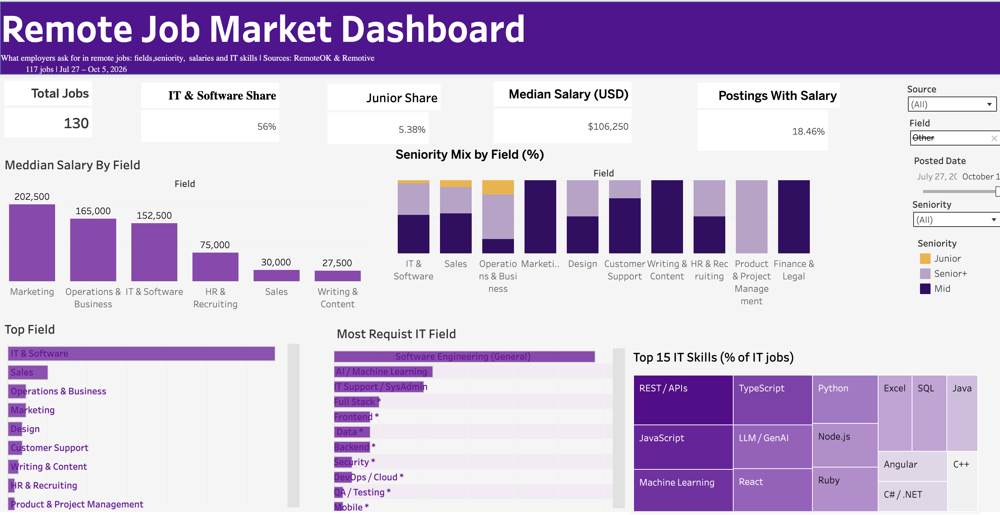
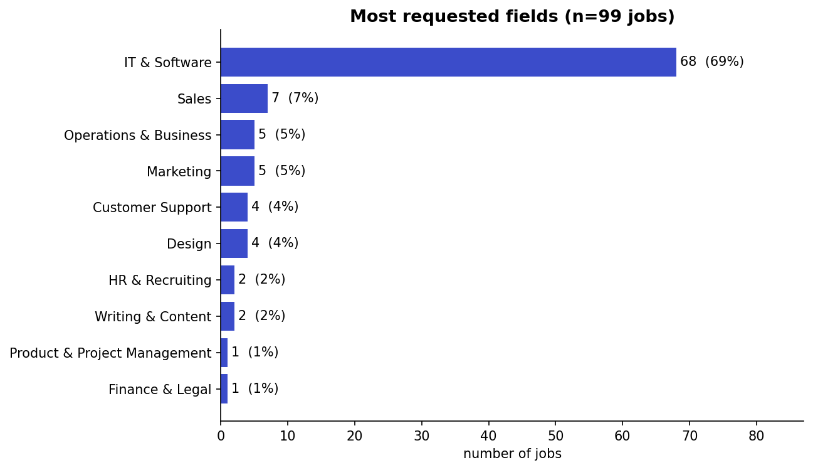
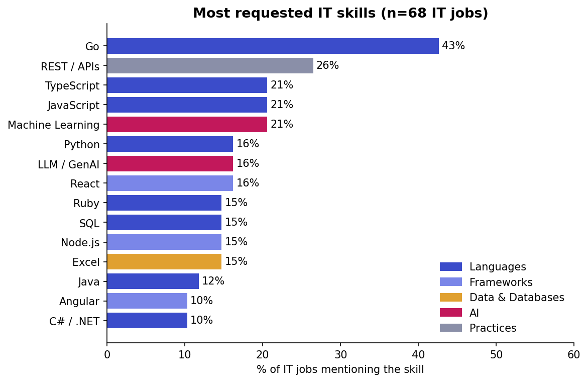
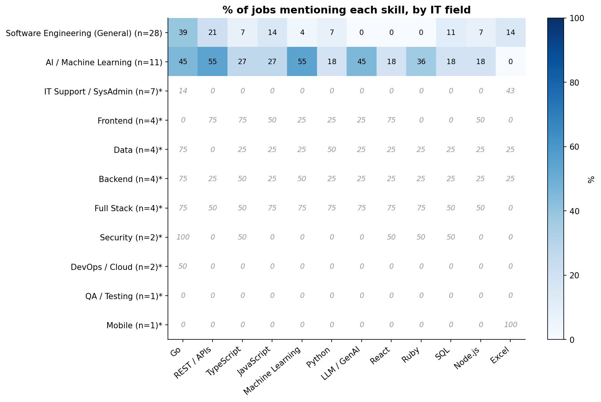

# Remote Job Market Analysis

> An end-to-end data project: collecting remote job postings from public APIs, cleaning them with Python and Pandas, analysing them with Python and SQL, and presenting the results in an interactive Tableau dashboard.

**Dashboard:** [View on Tableau Public](PUT-YOUR-TABLEAU-LINK-HERE)  <!-- replace after publishing -->



## Project goal

A learning project to practise the full data-analyst workflow on real, messy data. It answers:

**Part A: the remote job market**

1. Which fields are the most requested?
2. How do seniority levels (Junior / Mid / Senior+) differ between fields?
3. What salaries are shown for each field?

**Part B: IT deep dive**

4. Which IT fields (Backend, DevOps, Data, Security...) are the most requested?
5. Which skills does each IT field ask for?

## Data

| Source | Used for |
| --- | --- |
| [RemoteOK](https://remoteok.com) public API | latest remote jobs, all fields |
| [Remotive](https://remotive.com) public API | remote jobs from every Remotive category |

- **Sample:** `<N>` jobs, collected between `<YYYY-MM-DD>` and `<YYYY-MM-DD>`.
- Thanks to RemoteOK and Remotive for providing their data. Each job keeps a link back to its source.
- **Raw job postings are not included in this repository** (the sources ask not to republish their listings). Only text-free aggregated tables are shared in `data/clean/`.

## Workflow

| Step | File | What happens | Tools |
| --- | --- | --- | --- |
| 1. Collect | `notebooks/01_collect_jobs.ipynb` | Reads both APIs, merges new jobs with old ones, removes repeats | Python, Requests, Pandas |
| 2. Clean | `notebooks/02_clean_jobs.ipynb` | Fixes broken characters, strips HTML, parses salaries and tags, classifies each job into a field and a seniority level, detects 40 IT skills with regular expressions | Pandas, BeautifulSoup, Regex |
| 3. Analyse | `notebooks/03_market_analysis.ipynb` | Charts for each question, validation checks, key findings, export of tables for Tableau | Pandas, Matplotlib |
| 3b. SQL | `sql/analysis_queries.sql` | The same questions in SQL | SQLite |
| 4. Visualise | Tableau Public | Interactive dashboard with filters | Tableau |

## Repository structure

```
remote-job-analysis/
├── notebooks/
│   ├── 01_collect_jobs.ipynb
│   ├── 02_clean_jobs.ipynb
│   └── 03_market_analysis.ipynb
├── sql/
│   └── analysis_queries.sql              # SQL version of the analysis questions
├── data/
│   └── clean/
│       ├── jobs_for_tableau.csv          # one row per job, no text, no company names
│       ├── job_skills_for_tableau.csv    # one row per IT job and skill
│       └── jobs.db                       # SQLite database used for the SQL queries
├── docs/
│   └── data_dictionary.md                # meaning of every column
├── images/                               # charts and dashboard screenshot
├── requirements.txt
├── LICENSE
└── README.md
```

`data/raw/` (collected postings) and `data/clean/jobs_clean.csv` (contains job text) are created when you run the notebooks and are not tracked by Git.

## Key findings

> Numbers come from the "Key findings" cell at the end of `03_market_analysis.ipynb`. Sample size: `<N>` jobs.

1. **Most requested fields:** `<field>` (`<x>%`), `<field>` (`<x>%`), `<field>` (`<x>%`).
2. **IT & Software** is `<x>%` of the jobs in the sample.
3. **Entry-level jobs:** Junior roles are `<x>%` of all identified jobs and `<x>%` of IT jobs.
4. **Most requested IT fields:** `<field>` (`<x>%`), `<field>` (`<x>%`), `<field>` (`<x>%`).
5. **Most requested IT skills:** `<skill>` (`<x>%`), `<skill>` (`<x>%`), `<skill>` (`<x>%`).
6. **Salaries:** only `<x>%` of postings show a salary; the highest median among fields with 5+ salaries is `<field>` (`<value>`).





## What this means

<!-- Write 3-4 sentences in your own words, based on the numbers above. Examples of the kind of statement to make: -->
- What does the share of Junior roles say about entering remote work as a beginner?
- Which 3-5 skills would you learn first for the most requested IT field, and why?
- Which result surprised you?

## Method notes

- **Fields** come from the Remotive category when available, otherwise from keywords in the job title. IT jobs get a second, more detailed label (Backend, Frontend, DevOps / Cloud, Data, Security, QA...).
- **Seniority** is guessed from the title (`Junior`, `Senior`, `Lead`...). A title without a level counts as `Mid`, so the Mid share is probably overstated.
- **Skills** are detected in the title, tags and description with regular expressions, for IT jobs only (the skill list is technical). Skill percentages use the number of IT jobs as the denominator, and each job is counted once per skill.
- **Salary:** `0` in the source means "not provided" and is treated as missing. Medians are used instead of averages. Groups with fewer than 5 salaries are not compared.
- Groups with fewer than 10 jobs are marked `*` in the charts and should not be over-interpreted.
- **Validation:** a random sample of `<50>` jobs was checked by hand; field was correct in `<x>%`, seniority in `<x>%`. (See the validation cell in notebook 03.)

## Limitations

- Remote jobs only: the results describe the remote job market on two English-language job boards, **not** the whole job market of any country.
- The sources list only active postings, so older weeks look smaller than they were. The time chart describes the collection window, not a market trend.
- Field and seniority are inferred from text, so some jobs are misclassified.
- Few postings show a salary, so salary results are indicative only.
- The sample is small (`<N>` jobs).

## How to run

```
git clone https://github.com/sohaabed/remote-job-analysis.git
cd remote-job-analysis
pip install -r requirements.txt
jupyter notebook
```

Run the notebooks in order (`01` -> `02` -> `03`) from the `notebooks/` folder.
Notebook `01` waits between requests to respect the Remotive API limits (a full run takes several minutes). Run it **once a day at most**; each run adds new jobs to the collection.

Notebook `03` reads `data/clean/jobs_clean.csv`, which is created by notebook `02`. If you only want to see the results, open the notebook on GitHub or use the shared tables in `data/clean/` and the Tableau dashboard.

## Skills demonstrated

Web/API data collection · data cleaning and text processing with Pandas and regular expressions · feature engineering (field, seniority, skills) · exploratory analysis and visualisation with Matplotlib · SQL (JOIN, GROUP BY, window functions) with SQLite · dashboard design in Tableau · documenting limitations honestly.

## Author

**Soha** · [GitHub](https://github.com/sohaabed) · [LinkedIn](https://www.linkedin.com/in/your-profile)  <!-- replace with your real profile -->
